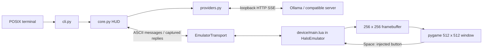
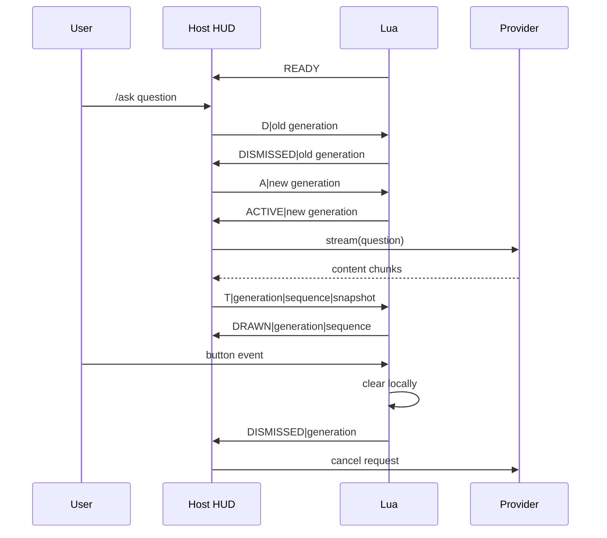

# Architecture

The host performs inference and text layout. Lua owns display state and local dismissal. The only application transport is `EmulatorTransport`; installing a Bluetooth library does not enable physical glasses.

## Responsibilities and data flow

- `cli.py`: selects provider, creates a temporary emulator filesystem, reads asynchronous stdin, runs optional viewer, saves explicit snapshots, cleans up on exit.
- `core.py`: normalizes text, wraps lines, tracks generations/sequences, waits for acknowledgments, cancels streams and records timing. The `reader` field is a protocol polling task, not a document reader.
- `providers.py`: mock word stream or HTTP SSE; no inference runs on the glasses.
- `device/main.lua`: starts blank, wakes panel state, registers single/long button callbacks, validates generation/sequence, draws and clears. Polls connection state every 5 ms.

## Ollama and local providers

CLI defaults are `http://127.0.0.1:11434/v1/chat/completions` and `gpt-oss:20b`. Auto selection probes `/v1/models` for that exact ID; failure selects an explicitly announced mock. Explicit local mode skips probing. Failures after selection clear the HUD and report failure; they do not switch answers to mock.

POST includes `stream: true`, `max_tokens: 512`, `reasoning_effort: low`, a brief-answer system instruction and the user question. SSE consumes `data:` JSON with `choices[0].delta.content`; reasoning-only chunks are ignored. `[DONE]` is required. This is a narrow compatible subset, not a general SSE implementation.

Only HTTP literal loopback IPs are accepted; hostname DNS, credentials, fragments, redirects and environment proxies are excluded. Connect timeout is 2 seconds, read timeout 30 seconds, total HUD stream deadline 60 seconds. Cancellation closes the client context; remote computation may continue briefly.

## Rendering

Host NFKD-normalizes to printable ASCII, collapses whitespace and wraps at 28 columns. It retains the last 4096 source characters and displays the last six wrapped lines. There is no scrollback UI. Lua uses Dogica regular 8 px, white on black, x=13 and y=77+16×row in the API coordinate system. The viewer scales the 256×256 image to 512×512. First changed text draws immediately; subsequent snapshots are capped at 30 Hz, with one draw acknowledgment outstanding.

Halo-style display writes are direct; `show()` does not prove a physical buffer flip. Clear-then-redraw may flicker on hardware. Fixed coordinates express head-locked intent but do not validate optics or motion stability.

## Application protocol

| Message | Meaning |
| --- | --- |
| `READY` | Lua callbacks registered |
| `A\|g` / `ACTIVE\|g` | Activate newer generation, initially blank / acknowledge |
| `T\|g\|s\|text` / `DRAWN\|g\|s` | Complete visible snapshot / completed Lua drawing |
| `D\|g` / `DISMISSED\|g` | Clear/deactivate / acknowledge or notify local dismissal |

Host packets are capped at 240 bytes; Lua accepts at most 174 text bytes and six lines. This is not a negotiated BLE MTU. Old generations, repeated activation of a dismissed generation, and non-increasing sequences cannot redraw. Activation/draw acknowledgment waits time out after one second. Provider/draw failures mark `failed` and send clear. Host clear is queued before waiting for provider cancellation.

## Privacy and failure boundaries

The interactive app writes no conversation log or telemetry. Prompts/answers still exist in host, HTTP and Lua memory, emulator captured messages, server logs and terminal scrollback. `/save` and the verification script explicitly persist content. Dismissal clears pixels and cancels work; it is not secure erasure. Server logging/outbound traffic are controlled outside this project.

There is no host-loss watchdog, retry/reconnect transport or secure physical pairing integration. A stalled host may leave the last answer visible until button dismissal or detected disconnect. Emulator connection state does not model radio failure. See [hardware](HARDWARE.md).
