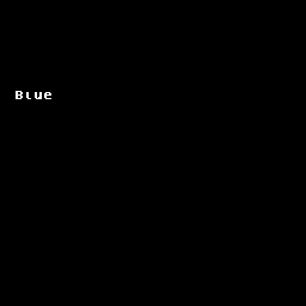
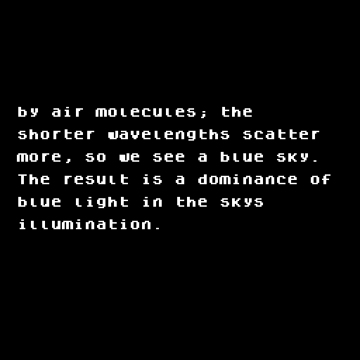
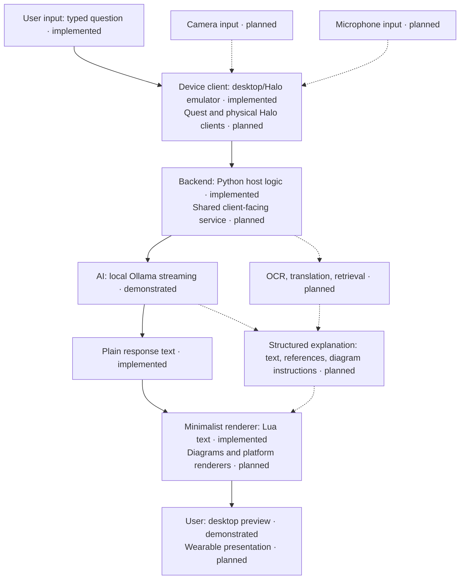

# Quiet Glasses

**Understand what is in front of you. Stay with what you are doing.**

Imagine looking at a Japanese menu, asking what a dish means, and reading a short
English explanation without reaching for your phone. Dismiss it, and your view is
quiet again. The conversation stays with the meal, the street, or the person
beside you.

Quiet Glasses explores that kind of interface: AI that helps interpret the
physical world, with as little visual interruption as possible.

> **Make the physical world readable, understandable, and navigable without
> requiring people to leave it to consult a computer.**

Today, this is a working desktop prototype of a small text display, not a finished
wearable. The experience above is a goal. The demonstrated foundation is more
specific: ask a question, watch a local AI answer stream into an emulated display,
and dismiss it.

## A quiet visual language

Technology should augment reality rather than compete with it. Quiet Glasses
starts with monochrome text and proposes adding simple line diagrams, arrows,
and annotations when they explain something better than words. Elaborate
holographic dashboards are unnecessary for understanding a label or recalling
what a component does.

Information should appear when requested and disappear when dismissed. The same
small set of actions—ask, read, navigate, dismiss—could serve many purposes,
without presenting each task as another application filling your field of view.

“AI-native” means starting with the question and its context instead of requiring
the user to find a program, choose a tool, and assemble an answer. It does not mean
asking AI to invent facts where a reliable reference would do.

The direction is open-source, privacy-conscious, and local-first where feasible.
Existing glasses, AI models, OCR libraries, and document sources should supply the
building blocks. This is an exploration of a human–computer interface, not an
attempt to manufacture smart glasses immediately.

## What wearing it might feel like

**These are proposed experiences, not demonstrations of current features.**

### Translation: stay in the conversation

A traveller in Japan pauses at a station sign: “Which exit takes me to the
museum?” A brief English explanation appears. At lunch, the same interface could
explain a menu item; later, it could translate a newspaper paragraph or clarify
which field to fill in on a form. The original text remains the reference, and
uncertain readings should be visible as uncertain. Camera capture, OCR, and this
translation workflow have not been implemented.

### Universal reference: bring the page to the task

At a workbench, you ask for a Wikipedia article. At a terminal, you ask for the
Unix manual entry for `rsync`. A controllable floating reading surface could let
you move by line, section, or page, then dismiss it without losing your place in
the task. This is a reading-interface proposal: the prototype currently shows
only the latest six lines and has no document loading or page navigation.

### Engineering: explain what you are looking at

You examine a circuit board and ask, “What is this component doing?” A possible
answer combines a component label, a verified pinout, and a small annotated
signal-flow diagram. Useful assistance would distinguish identification from a
guess and point to the relevant datasheet. Board recognition and precise alignment
of labels to physical parts remain future work.

### Learning: keep the thread

An unfamiliar term interrupts your reading. Rather than switch screens and risk
falling into a different task, you request a two-sentence explanation and perhaps
a tiny diagram. The aim is enough understanding to continue, with a deeper
reference available on request. Context capture and diagrams are planned; the
existing question-and-answer prototype is the starting point.

### Procedures: help without false confidence

While assembling a low-risk object, you request the next step and keep both hands
near the work. Contextual instructions could reduce repeated trips to a manual.
Accuracy matters: an incorrect component, measurement, or instruction can cause
harm. High-risk uses such as medical guidance would require authoritative
sources, appropriate expert oversight, and separate safety validation. This
prototype has no demonstrated clinical reliability or suitability for medical
instructions.

## What has actually been built

The application has two small parts. A **Python host** handles requests, local
inference, cancellation, text layout, and timing. A **Lua application** owns the
display and its dismissal behavior inside the official **Brilliant Labs Halo
emulator**. A desktop window shows the emulator's 256×256 framebuffer.

The host connects to **Ollama running `gpt-oss:20b`** through a local streaming API.
A mock provider keeps the interface testable without a model; automatic fallback
is announced explicitly. No AI model runs inside the emulated glasses.

| State | Evidence |
| --- | --- |
| **Implemented and tested** | Blank startup, explicit question activation, streamed ASCII text, cancellation, dismissal, and rejection of late/stale messages; 23 automated tests recorded in the latest repository audit. |
| **Demonstrated with real inference** | A preserved Ollama/X11 run, its timing report, and the four captures below. |
| **Implemented, not physically validated** | The Lua renderer and button callbacks, including explicit display wake and protected Bluetooth notifications. Hardware-contract tests inject failures in the emulator. |
| **Planned** | Physical BLE transport, Quest client, document reading/navigation, OCR, translation, and diagrams. |
| **Speculative longer-term direction** | Precise world-aligned annotations and hardware optimized for this interaction. |

**No physical smart-glasses deployment has been demonstrated.** The emulator
transport is the only implemented connection to a device runtime. See the
[architecture](ARCHITECTURE.md) and [testing evidence](TESTING.md) for details.

### The actual demo

The recorded question was: **“In two short sentences, why does the sky look blue?”**
These are original captures of the desktop emulator window, not optical
photographs or conceptual mockups.

| 1 · Blank | 2 · First response |
| --- | --- |
|  |  |
| Nothing competes for attention before a request. | The answer begins appearing while generation continues. |

| 3 · Completed response | 4 · Dismissed |
| --- | --- |
|  |  |
| The latest six lines remain; earlier text has rolled out of view. | Dismissal clears the display; it does not securely erase memory. |

The PNGs are unchanged copies from `artifacts/real-demo/`, bundled here so this
page does not depend on Git-ignored experiment output.

### Measured, with boundaries

| Recorded observation | Result |
| --- | ---: |
| Activation → first model content | 3,686.742 ms |
| Activation → first Lua draw acknowledgment | 3,688.308 ms |
| Activation → first nonblank window flip | **3,705.402 ms** |
| Acknowledged text snapshots | 41 |
| Injected button event → observed blank framebuffer | 2.469 ms |

This is one warm-model observation, not a performance guarantee or physical
latency benchmark. Window flip timing does not measure light reaching an eye.
The button event was already classified by the emulator; real Halo single-click
recognition adds roughly 400 ms after release. A separate mock observation reached
a draw acknowledgment in 26.214 ms, but excludes real inference. The
[experiment log](EXPERIMENTS.md) preserves the measurement context and its missing
metadata.

## One idea, several possible clients

The proposed architecture separates interpreting a request from presenting it.
**Solid arrows and “implemented” labels describe today's emulator path; dashed
arrows describe proposed extensions.**

Today, the backend is a local Python host, not a shared network service. Responses
are plain text, not structured diagrams or anchored objects. Provider and display
responsibilities are already separate enough to suggest reuse, but portability is
still work: each device needs its own input, transport, permissions, and renderer.
A wearable client would also require deliberate networking because the current
provider accepts only loopback endpoints.

## Two hardware paths, different questions

**Meta Quest 3 — owned development hardware, planned client.** Full-color
mixed-reality passthrough can keep the room visible while spatial text and diagrams
are presented. That makes it a useful place to explore reading surfaces and,
potentially, camera-based translation or object explanation. Meta documents both
[passthrough](https://developers.meta.com/vr/essentials/horizon-os-passthrough/)
and a permission-controlled
[Quest camera API](https://developers.meta.com/vr/documentation/spatial-sdk/spatial-sdk-pca-overview/).
A Quest-specific application is still required; none is completed in this repository.

**Brilliant Labs Halo — existing emulator, unvalidated physical integration.**
Lightweight glasses with a small display are a more plausible starting point for
compact, glanceable answers than full-page reading. The existing SDK and Lua
prototype provide a starting point, but physical BLE integration, optical
readability, fit, redraw behavior, and battery life still need validation. The
[hardware audit](../HARDWARE_COMPATIBILITY_AUDIT.md) gives a conditional recommendation
for one experimental pair, not a claim of deployment readiness.

Longer term, this interface may benefit from purpose-designed hardware. Custom
hardware development is outside the current scope.

## What might be different

Translation, visual AI, and AR annotation are not new inventions. Meta already
provides mixed-reality tools; Google has demonstrated
[Android XR translation experiences](https://blog.google/products-and-platforms/platforms/android/android-xr-gemini-glasses-headsets/);
Brilliant Labs supplies programmable glasses. Other AR companies explore displays,
assistants, and contextual computing.

Quiet Glasses proposes **a restrained, consistent, user-controlled visual language
for understanding the physical world**. Reading, translation, diagrams, and
explanation should feel related, without turning the entire visual field into a
busy desktop. Whether that reduces distraction or makes tasks more enjoyable is a
product hypothesis, not a demonstrated advantage over existing products.

## Next milestones

These are the proposed sequence for this concept brief, not completed work or
promised dates. Earlier repository planning prioritized a first physical Halo
prototype; the Quest-first sequence below uses hardware already owned.

1. **Complete the portable software foundation:** clarify client/backend boundaries while retaining the working emulator baseline.
2. **Deploy a Quest 3 mixed-reality demo:** test readable text, placement, and reliable dismissal.
3. **Demonstrate translation and reference reading:** add deliberate capture/loading and controllable navigation.
4. **Evaluate real-device usability:** observe readability, latency, distraction, comfort, and interaction failures.
5. **Consider a lightweight glasses prototype:** use the Halo audit and actual needs to decide the next physical experiment.
6. **Explore precise spatial annotations later:** only after a useful reading-and-explanation interface exists.

## A personal project, open to collaboration

The immediate aim is to build something useful and enjoyable, not to launch a
company or raise investment. Hardware partnerships or commercialization are
optional future directions, not established plans.

This is a personal project pursuing open-source development. The visible snapshot
has no project license or verified public repository URL; the owner must resolve
those before presenting it as a fully published open-source release. Prospective
contributors can obtain the source from the maintainer, follow [setup](SETUP.md),
and run `./launch --provider mock` after installation. Tests run with
`.venv/bin/python -m pytest -q`.

The [README handoff](../README.md#handoff-and-contribution) favors small, complete
changes and clear separation of emulator and hardware evidence. Useful
contributions include reproducible usability observations, reader interaction
proposals, or a focused device integration. There is no contribution portal to
invent here.

Local-first is a practical preference, not a privacy guarantee. The current app
restricts model requests to loopback and does not automatically save conversations;
server logging, terminal history, memory, and explicit screenshots still matter.
Future camera and microphone use needs deliberate consent and data handling.

Quiet Glasses is worth exploring because the useful question is approachable:
can a little well-timed information help us understand what is in front of us,
then get out of the way?
